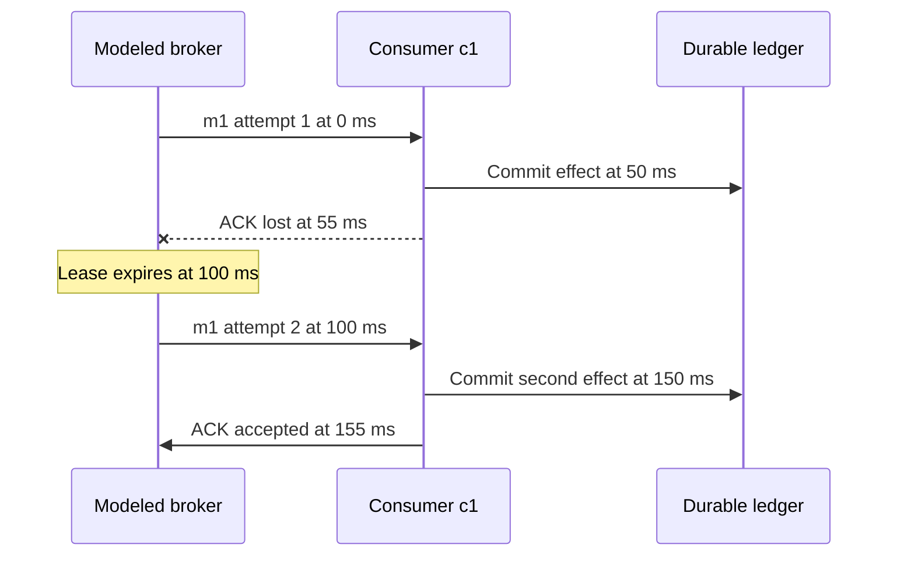

# Queue delivery: implementation handoff

Prepared 2026-10-12 against `7a214d7` (PR #61). **Original handoff, with implementation progress below.**
[HLD-14A](work-items/HLD-14A.md) implements the pure Java delivery model and standalone
contracts. Descriptor/API and React learning coverage remain pending. Use this with the [implementation plan](IMPLEMENTATION_PLAN.md),
[curriculum](CURRICULUM.md), [simulation contract](SIMULATION_SPEC.md),
[content contract](../content/CONTENT_SPEC.md) and [learning standard](LEARNING_STANDARD.md).

## 1. Outcome and development order

The learner should explain why a queue can deliver a message twice, distinguish delivery
attempts from durable business effects, and choose where acknowledgment and duplicate
protection belong. One sentence: **a queue can retry delivery; your application must decide
what repeating the work means.**

Use the existing curriculum ID `queues-delivery`. Its prerequisite is `queues-tail-latency`,
which depends on the already implemented capacity and request-flow modules. The
capacity/waiting prerequisite now has a Java model and explicit draft API/UI in
[HLD-13A](work-items/HLD-13A.md) and [HLD-13B](work-items/HLD-13B.md).
[HLD-13C](work-items/HLD-13C.md) adds its complete core Guided/architecture/job-path teaching
flow; consult that contribution's actual verification evidence before dependent development.
The pure delivery model and standalone schemas are now implemented in HLD-14A; its descriptor/API and learning module remain pending. The prerequisite's
finite in-memory worker queue and the proposed durable broker are different boundaries;
explain the distinction explicitly.

[Decision 0022](decisions/0022-development-and-publication-gates.md) allows unpublished
development before first-release human/hosted reviews finish. Publication still requires
P2-05 and published prerequisite closure. This document records the preparation and versioned model decisions; work items supply actual implementation evidence.

The first delivery model has **no deduplication**. The later `idempotency` module needs
`transactions-isolation` and `queues-delivery`; implement those prerequisites before adding
atomic duplicate protection. Notifications then reuse these concepts without claiming
that broker acknowledgment proves an external provider performed an effect once.

## 2. One consistent example

Model one durable accepted message `m1`, one consumer `c1`, and a durable ledger. A completed
attempt appends one ledger record worth one unit. This is an illustrative effect, with no
actual email, payment, database, broker SDK or external network call.

| Parameter | Baseline |
| --- | --- |
| Enqueue | 0 ms |
| Processing duration | 50 ms from delivery |
| Acknowledgment delay | 5 ms |
| Visibility lease | 100 ms from each delivery |
| Maximum delivery attempts | 3, including the initial delivery |
| Consumer capacity | One processing slot |
| Default policy | `ACK_AFTER_EFFECT` |

**Acknowledgment (ACK)** means the broker accepted confirmation for its current delivery.
It does not inspect the ledger. **Effect** means the ledger append committed and survives
consumer failure. The broker and ledger do not share a transaction.

Under `ACK_AFTER_EFFECT`, delivery at 0 ms schedules the effect at 50 ms and ACK at 55 ms.
Under `ACK_BEFORE_EFFECT`, ACK is at 5 ms and the effect remains scheduled for 50 ms.
Validate `acknowledgmentDelayMs < processingTimeMs` for the before-effect policy so the
policy name remains true. For the after-effect policy, ACK delay is measured from commit.
Network transport latency is zero; a scheduled ACK can deliberately be lost.

### Core experiment: lose the first ACK



Text equivalent: the first attempt adds a ledger record, but the broker never receives its
ACK. At lease expiry the message becomes eligible again. A second attempt adds another
record and successfully acknowledges. **Two deliveries, two effects, one extra effect.**
The broker's uncertainty does not erase the first committed record.

## 3. State and failure semantics

Define these rules in Java and the versioned descriptor before writing the renderer:

1. Broker state per message: `NOT_ENQUEUED`, `READY`, `LEASED`, `ACKNOWLEDGED`, `DEAD_LETTERED`.
   Consumer state: ready/down plus its current processing attempt. Attempt state records
   processing, committed/cancelled effect and ACK disposition separately; one terminal enum
   cannot represent all these independent facts.
2. Each delivery has a new attempt ID (`m1-a1`, `m1-a2`) and lease token. Only the matching
   current token with broker receipt strictly **before** its deadline is accepted. Tokens expire
   at the deadline. This strict stale-token rule is our model policy, not an SQS promise.
3. The processing slot becomes free when the effect commits or processing is cancelled.
   A pending unsent ACK remains local to the consumer and can be cancelled by a later crash.
   An accepted early ACK does not free the processing slot or end the run.
4. A consumer crash cancels its uncommitted effects and pending unsent ACKs. Committed ledger
   entries survive. Crash does not immediately requeue a leased message; its lease must expire.
   Recovery makes the consumer available, without reviving cancelled attempts.
5. At lease expiry, invalidate the token. Requeue if fewer than the allowed attempts were
   delivered; otherwise move the message to the modeled dead-letter collection. Expiry
   does not cancel a still-running consumer or fence the ledger. A late effect can commit
   after requeue or dead-lettering. Dead-lettered does not mean “no effect occurred.”
6. Broker eligibility and consumer capacity are both required for delivery. If a lease
   expires at 100 ms while the consumer remains down until 102 ms, deliver at 102 ms.
7. Dispatch eligible messages by `(availableSinceMs, original input index)` and available
   consumers by input order. Requeue sets availability to the expiry timestamp. This
   deterministic policy does not promise FIFO effect completion or global ordering.
8. Keep fault schedules explicit. A crash/recovery still executes if its message was already
   acknowledged and processed. Lost-ACK selectors target a message and delivered attempt;
   report selectors never reached, rather than inventing an ACK or attempt.

The ACK pipeline is `ack.sent` followed by either `ack.lost` (nothing reaches the broker)
or broker receipt classified as `ack.accepted`/`ack.stale`. Apply configured transport loss
before receipt validation: an ACK dropped at an expired deadline is lost, not stale. No
single sent ACK has both dispositions. Test this combined input as well as the normal cases.

### Same-time ordering

Use `(timeMs, phase, schedulingSequence)` in this new model:

| Phase | Action |
| --- | --- |
| 1 | Commit effects and release processing slots |
| 2 | Expire leases and invalidate tokens |
| 3 | Send/lose/accept/reject ACKs |
| 4 | Crash consumers and cancel remaining local work |
| 5 | Recover consumers and enqueue arriving messages |
| 6 | Dispatch eligible work |

Same-phase ties use insertion order. Positive processing/ACK/lease durations prevent a
dispatch from scheduling an earlier phase at the same timestamp. At an effect/crash tie,
the effect survives; at an ACK/crash tie, ACK happens first. An ACK reaching the broker at
the lease deadline is stale. These are declared teaching rules, not wall-clock races or vendor behavior.

The shared `SimulationContext` currently supplies budgets and randomness; its `EventEmitter`
accepts the concrete request-flow event type. It supplies no reusable virtual scheduler.
The generic model interface and registry in the simulation specification are proposals.
Implement a concrete queue model first. Any minimal typed budget/emission extraction or
phase-order addition needs a reviewed ADR, actual serialization checks and existing-model
regressions. Do not silently change the tie rules of request flow or cache.

### When execution ends

Do not stop because the broker queue is empty or a message is ACKed. Process all valid
pending effects, ACKs, lease expiries and explicit crash/recovery/enqueue actions. Ignore
invalidated lease timers and cancelled callbacks; they must not extend the observation
window or trigger an otherwise unnecessary time limit.

`completed` means execution settled, including possible business loss or repeated effects.
Drain valid scheduled actions within budgets before classifying a stall: a remaining
enqueue or lease expiry can still change broker state even when no consumer can recover.
After no valid scheduled actions remain, if ready work still exists and every consumer
is down, return `limited` with the proposed reason `no_future_progress` and truthful pending counts.
The new reason is implemented in the standalone domain model; no delivery HTTP route is registered yet. Existing event/byte/virtual-time/wall-time limits
remain distinct. A limited run is an observed prefix, not proof that an ACKed message will
never receive its still-pending effect.

## 4. Fixtures an implementation must satisfy

All rows use the baseline above. Each fault targets the first attempt only; “before/after”
refers to the two ACK policies. One accepted ACK is possible per message in these fixtures.

| First fault | ACK policy | Deliveries | Effects | Extra effects | Accepted ACK at | ACKed without effect after settlement |
| --- | --- | ---: | ---: | ---: | ---: | ---: |
| None | After effect | 1 | 1 | 0 | 55 ms | 0 |
| None | Before effect | 1 | 1 | 0 | 5 ms | 0 |
| Crash 25 ms; recover 75 ms | After effect | 2 | 1 | 0 | 155 ms | 0 |
| Crash 25 ms; recover 75 ms | Before effect | 1 | 0 | 0 | 5 ms | 1 |
| Crash 52 ms; recover 102 ms | After effect | 2 | 2 | 1 | 157 ms | 0 |
| Crash 52 ms; recover 102 ms | Before effect | 1 | 1 | 0 | 5 ms | 0 |
| Lose first ACK | After effect | 2 | 2 | 1 | 155 ms | 0 |
| Lose first ACK | Before effect | 2 | 2 | 1 | 105 ms | 0 |

Crash at 25 ms with ACK-after cancels the first effect; lease expiry at 100 ms allows attempt
2, effect at 150 ms, ACK at 155 ms. This is **one redelivery with zero extra effects**.
Crash at 52 ms with ACK-after retains the first effect but cancels its pending ACK. The lease
expires at 100 ms, recovery is at 102 ms, the second effect is at 152 ms and ACK at 157 ms.
Lost early ACK gives a second accepted ACK at 105 ms but its effect at 150 ms; stopping at
105 ms would give a false effect count. Crash/recovery at 52/102 ms still appears in the
before-effect row even though the message's processing already ended at 50 ms.

Additional exact checks:

| Changed condition | Required result |
| --- | --- |
| Maximum attempts 1; crash 25/recover 75; ACK-after | One delivery, zero effects/accepted ACKs, dead-letter at 100 ms |
| Processing 95; ACK delay 5; lease 100; max attempts 2; ACK-after; no fault | Effects at 95/195 ms; lease expiry and stale ACK at 100/200 ms; retry at 100 ms; dead-letter at 200 ms; two effects, zero accepted ACKs |
| Same preceding row, lease 101 | One delivery/effect; ACK accepted at 100 ms; cancelled expiry does not emit at 101 ms |
| Crash at 49 versus 50; recover 75; baseline ACK-after | At 49: one eventual effect. At 50: first effect commits before crash; retry gives two effects. Both ACK attempt 2 at 155 ms |
| Crash at 0; no recovery; enqueue m1 at 0 | No delivery/effect/ACK; m1 remains ready; limited/no_future_progress, never completed success |

Also test two consumers with processing longer than the lease: an expired first worker may
commit while the second attempt processes. Moving a message to dead-letter must not erase
an already scheduled valid effect. Check exact IDs, causal order and state; a nonempty trace
or a plausible animation is insufficient evidence.

## 5. Proposed inputs, events and metrics

The standalone input/result schemas and Java records now implement these targets. They are not registered in OpenAPI.
The implemented model uses version `1.0.0` and schema version `1.0`; align HTTP representations
with actual current API conventions when implementing and reject unsupported versions.

| Input | Inclusive proposed bounds / rule |
| --- | --- |
| Messages | 1–20; unique IDs matching `[a-z][a-z0-9-]{0,31}`; enqueue time 0–60,000 ms |
| Consumers | 1–3; unique IDs using the same format; one processing slot each |
| `processingTimeMs` | Integer 1–1,000 |
| `acknowledgmentDelayMs` | Integer 1–1,000; less than processing time for ACK-before |
| `visibilityTimeoutMs` | Integer 1–60,000; may be shorter than processing |
| `maxDeliveryAttempts` | Integer 1–5, including the first |
| `acknowledgmentPolicy` | Exactly `ACK_BEFORE_EFFECT` or `ACK_AFTER_EFFECT` |
| Consumer failure actions | 0–8 entries total: consumer ID, `CRASH`/`RECOVER`, integer time 0–60,000 ms; start ready, alternate per consumer, reject same-consumer/same-time duplicates |
| Lost ACK selectors | 0–20 unique message-ID/attempt-number pairs; message must exist; attempt 1–max attempts |
| Seed | Signed JavaScript-safe range ±9,007,199,254,740,991; no random choices, so changing the seed need not change behavior |

Reject null/unknown fields, wrong types, nonintegers, invalid enums, unknown IDs, impossible
failure schedules and unsupported versions. Validate direct domain invocation too. HLD-14A accepts unsorted input arrays, validates chronological failure alternation using sorted copies, and retains original indexes. Equal-time recovery is inserted before enqueue. Pending ACK count includes planned ACK-after; unknown ACK-without-effect remains unavailable on every limited prefix. Check
overflow before time arithmetic; a valid arrival whose work extends beyond 60,000 ms gets
an honest virtual-time limited result rather than an invented completion.

At most 100 deliveries and ledger records follow from these input bounds. Reuse the shared
10,000-event / estimated 2 MiB event-array / 60,000 ms virtual / cooperative 10-second wall
guards and existing HTTP caps (256 KiB body, 4 MiB complete result, two synchronous runs per
process). These are ceilings, not throughput or production memory promises. Maximum inputs
may legitimately produce a limited result. Verify actual UTF-8/escaped event serialization,
non-event field bounds, permit recovery and request isolation.

Proposed closed event vocabulary:

```text
message.enqueued       delivery.started        effect.committed
ack.sent               ack.accepted            ack.lost
ack.stale              lease.expired           message.requeued
message.dead-lettered  consumer.crashed        consumer.recovered
attempt.cancelled
```

Each event has `sequence`, `timeMs`, `kind`, narration for display, and typed affected
message/attempt/consumer identities where applicable. Token identity belongs to the
attempt. Include bounded post-event state for affected entities and a ledger append
record only when committed. Specify event-kind required/forbidden fields in the schema;
do not use arbitrary maps or infer changes by parsing narration. Keep emitted sequence
separate from scheduling order. A cause reference, if added, must point to an earlier
emitted event and needs its own contract/test.

Result includes model/schema versions, seed, assumptions, initial state, events, final state,
per-message and per-attempt outcomes, ledger and metrics. Limited results include the exact
reason, last emitted virtual time and pending populations. Check that the state shown at
each emitted event agrees with its typed snapshot and does not reveal later transitions.
Admit the event or complete event batch for one logical transition before committing its
state changes. If an event/byte/time guard rejects admission, leave state, ledger and
counters at the last emitted prefix and report the remaining work. Do not return a partly
emitted transition batch or a committed effect absent from its trace. Implement and test
this narrow queue requirement without retroactively claiming current emitters provide it.
Define failure actions or lost-ACK selectors not reached before truncation separately from
those never reached in a completed run.

| Metric | Definition |
| --- | --- |
| Delivery attempts | Actual dispatch count |
| Redeliveries | Sum over messages of `max(deliveries - 1, 0)` |
| Committed effects | Ledger record count |
| Messages with effect | Distinct message IDs in the ledger |
| Extra effects | Sum over messages of `max(effect count - 1, 0)`; this model treats every append as additional work |
| Acknowledged messages | Distinct messages accepted as ACKed by the broker |
| ACKed without effect | ACKed messages with no ledger entry after full settlement; incomplete/pending cases are unknown, not confirmed loss |
| Dead-lettered messages | Broker terminal state count; does not imply zero committed effects |
| Outstanding work | Ready/leased messages, running effects and pending ACKs separately |

ACK latency and first-effect latency are separate populations measured from enqueue, in ms,
with sample counts and unavailable values for empty populations. Do not introduce a single
success percentage or production throughput from this tiny batch. Label summary metrics
as final-run or observed-prefix values while stepping through earlier events.

## 6. React experience and teaching

Use LLD's integrated operations/simulation/diagrams/design experience as the product
reference; preserve HLD's existing `ModuleShell`, URL-selected views, semantic tokens and
manual-activation keyboard tabs. The sibling blocking queue is an in-memory thread
coordination example, not the broker semantics to copy here.

1. Open with “If work finishes but the queue misses its confirmation, what happens next?”
   Show the one-message example and a short definition of ACK, effect and lease.
2. Offer baseline, crash-before-effect, crash-after-effect and lost-ACK presets. Keep policy
   and meaningful timings editable. Fault labels describe exact configured times; don't
   keep calling an edited crash “before effect” when the new processing time changes that.
3. Invite a prediction: how many deliveries and effects? Allow reference reveal without
   requiring an answer; preserve original/revised reasoning using existing local storage.
4. One explicit Run sends validated inputs to Java. Separate draft controls, submitted
   inputs and result; field edits label results stale. Lock presets while pending and
   ignore stale responses. Playback/replay/seek must not send additional run requests.
5. Diagram: **Broker → Consumer → Ledger**, plus ACK back to Broker. Show ready/leased,
   down/processing, attempt/token deadline and actual ledger entries. Keep all labels in
   a nearby structured text table. Color supports text; it does not carry the only meaning.
6. Step/back/reset/seek/play/pause/speed drive the returned trace. Reconstruct presentation
   from initial state and typed post-event state; filtering a message must still apply all
   preceding events. Keep metrics from Java; never recompute retries or effect outcomes.
7. At the lost ACK, explain “the ledger has a record; the broker still has no confirmation.”
   At retry, display the new attempt under the same message. At the second effect, connect
   the extra record to the missing atomic duplicate-protection boundary.
8. End with a teammate explanation, interview scaffold and changed-condition question.
   Teach ACK-after as a useful baseline with a remaining duplicate window. ACK-before
   risks confirmed delivery without work. Neither policy alone protects an external effect.

Guided targets should identify preset, message, attempt, event kind and occurrence.
The current guided-checkpoint schema supports cache operation and queue-capacity job selectors
(HLD-13C). Delivery needs its own explicit message/attempt selector with backward-compatible
validation/tests for both existing models. Never fit delivery attempts into invented cache
operation numbers, capacity job IDs or event array indexes.
The existing kind pattern excludes the hyphen in `message.dead-lettered`: the delivery selector
must validate against its own closed event vocabulary while retaining the existing cache and
capacity selectors' validation. Updating only the selector IDs would leave this checkpoint invalid.

Practice should cover lost ACK, crash-before/after effect, expiry-boundary comparison,
two-worker overlapping attempts, retry exhaustion and a transfer to an order-processing
job. A tempting wrong answer is “ACK-after means the work cannot repeat.” Correct it with
the 50/55/100/150 ms example. The later protection exercise must name its atomic boundary
and discuss a provider outside it.

Acceptance: 320/768/1440 CSS pixels, both themes, 200% zoom, keyboard-only run/step/seek,
focus retained on controls, reduced-motion manual playback, hidden-panel pause, and no
page overflow. Review no-run, loading, invalid input, unreachable API, busy/oversized
HTTP errors, incompatible result, empty trace, limited trace and changed-input states.
Announce completion/errors without flooding a live region during playback. Require an
actual screen-reader and newcomer explain-back before publication; automation is supplementary.

## 7. Claims and primary references

Reviewed 2026-10-12. Write original explanations; no source code, diagrams or assets copied.
Use these sources for scoped claims, not as specifications for the deterministic timings.

| Source | Supported claim and boundary |
| --- | --- |
| [RabbitMQ 4.3 ACKs and publisher confirms](https://www.rabbitmq.com/docs/confirms) | Producer confirms and consumer ACKs cover separate interactions. AMQP 0-9-1 requeues unacknowledged deliveries on channel/connection loss; this model instead waits for lease expiry. |
| [SQS visibility timeout](https://docs.aws.amazon.com/AWSSimpleQueueService/latest/SQSDeveloperGuide/sqs-visibility-timeout.html) | Receiving differs from deleting; expired visibility permits another delivery. SQS can duplicate during visibility too; this model suppresses that additional failure mode. |
| [SQS DeleteMessage](https://docs.aws.amazon.com/AWSSimpleQueueService/latest/APIReference/API_DeleteMessage.html) | Receipt handles change across receives; an old handle can return success without deletion. Our deterministic stale-token rejection must not be presented as this API's guarantee. |
| [AWS safe retries and idempotent APIs](https://aws.amazon.com/builders-library/making-retries-safe-with-idempotent-APIs/) | Protecting a request identity and effect requires an appropriate atomic boundary. The later module must address scope/retention; a local record alone cannot transact with an unrelated external provider. |

Omitted: producer failures/confirms, broker replication/loss, real failure detection, actual
network races, lease extension, transactions, dedupe, provider responses, negative ACK APIs,
backoff/jitter, batching, broker-specific ordering and retention. Introduce each mechanism
only when a concrete versioned experiment needs it. Explain delivery guarantees within
these assumptions; do not promise unconditional at-least-once processing under bounded
attempts, or exactly-once email/payment.

## 8. Delivery sequence and checks

Rows 1–2 now have implementation evidence in HLD-13A/B/C and HLD-14A; later rows remain future work. Use one focused branch/PR
per contribution, actual local checks, required final-head CI, squash merge and updated main.

The completed capacity prerequisite uses this calculable fixture: four jobs
arrive at 0 ms, one worker takes 10 ms per job, and one waiting slot is available. In input
order, two jobs are admitted and two rejected at 0 ms. The admitted jobs wait 0/10 ms and
finish at 10/20 ms; mean successful latency is 15 ms. Define queue capacity as waiting slots,
excluding workers. Increasing waiting capacity to three admits all four: waits 0/10/20/30 ms,
completions 10/20/30/40 ms, mean successful latency 25 ms. More buffering changes rejection
and latency, without creating more processing capacity. Use a shared worker queue and
per-job service durations to teach a concrete difference from request-flow's per-node queues.

| Order | Contribution | Evidence before moving on |
| --- | --- | --- |
| 1 | `queues-tail-latency`: contract and pure Java model, then deliberate draft API/route and complete learning experience | Tiny capacity/wait/rejection fixtures, contrasting arrival/service input, bounds, real API/browser flow and honest draft visibility |
| 2 | Queue-delivery domain contract, concrete Java scheduler/model and narrow necessary budget integration | All section 4 fixtures, state invariants, typed events, replay, direct validation and existing-model regressions |
| 3 | Descriptor/run API and packaged resources; explicit draft preview support | OpenAPI/generated types, strict parsing, real-HTTP schema checks, byte limits, isolation, admission/error/recovery and draft discovery exclusion |
| 4 | React draft playground/playback plus one lesson/example/practice flow | Real Java lost-ACK journey, exact timeline/effects, seek reconstruction, error/limited states, tab/history and mobile/theme/keyboard behavior |
| 5 | Guided checkpoints, architecture/sequence/design details and full practice | Java resolves each authored selector; teaching arithmetic/source references and saved-answer lifecycle agree |
| 6 | Release review and publication | P2-05, published prerequisites, all declared capabilities, human learning/accessibility evidence and complete module checks |
| 7 | Timeouts/retries; storage/transactions prerequisites; idempotency; integrated cases | Respect curriculum closure and independently verify each new guarantee |

Verification commands; actual executed scopes/results are recorded in HLD-14A. A browser check does not yet exercise a delivery renderer:

```bash
node scripts/validate-plan.mjs
(cd backend && ./mvnw -B verify)
(cd frontend && npm run contracts:check && npm run typecheck && npm run lint && npm run format:check && npm test && npm run build)
(cd frontend && npm run e2e)
python3 scripts/packaged-runtime-smoke.py --jar backend/target/hld-backend-0.1.0-SNAPSHOT.jar
```

Run builds before browser servers and never replace their jar/dist mid-run. Extend actual
runtime/browser checks when registering a model; a passing test suite that never exercises
the new model is insufficient. Report remaining manual checks and partial capabilities,
and update the authoritative roadmap without marking this preparation as module completion.
